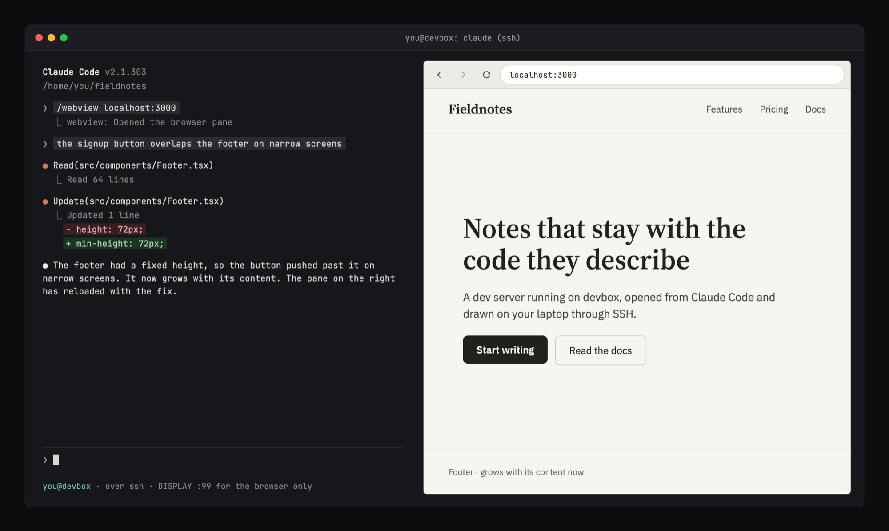

# webview

Opens [terminal-browser](https://github.com/zenbu-labs/terminal-browser), a real Chromium browser drawn in the terminal, in a pane inside Claude Code. Type `/webview` and the browser opens to the right of the conversation. The difference from the upstream plugin: it also works when Claude Code runs on a remote machine you reached over SSH.



This is a fork of the zenbu-labs `terminal-browser` Claude Code plugin, version 0.0.2. It keeps that plugin's behaviour and adds two fixes for SSH sessions.

## What it fixes over SSH

**Frames go as PNG.** The upstream plugin hands each browser frame to Claude Code as a POSIX shared-memory object, which the terminal reads directly. Over SSH the terminal runs on another machine and cannot read that memory, so Claude Code refuses the frame and the pane stays empty. This plugin tries shared memory first. If Claude Code refuses it because the terminal cannot read files on this machine, the plugin switches to sending each frame as a PNG for the rest of the session. `hooks/png-relay.py` reads the frame, deletes it, and encodes it. It also deletes any older frames that were skipped while it worked. A frame over Claude Code's 2 MiB limit is compressed harder, then halved in size until it fits.

**The browser gets a display.** The upstream plugin's bridge process runs Electron, which exits at once on a Linux server with no display (`Missing X server or $DISPLAY`). The plugin then reports the browser as opened and draws an empty pane. When a virtual display is running at `:99`, this plugin starts the bridge with `DISPLAY=:99`. Nothing else on the machine sees that variable.

On a local terminal neither fix is used, and the plugin behaves like upstream.

## What it depends on

webview does not need the upstream terminal-browser Claude Code plugin: it carries its own copy of that code. It does need the terminal-browser program and a few things on the machines involved.

| Piece | Where | Needed | What it does | How it gets there |
|---|---|---|---|---|
| [terminal-browser](https://github.com/zenbu-labs/terminal-browser) program, tested with v0.13.4 | The machine running Claude Code | Always | Runs Chromium. Its `claude-bridge` command hands each frame to this plugin. | Install step 1 |
| Claude Code function hooks | The machine running Claude Code | Always | Let a plugin draw a pane | Install step 2 |
| A kitty-graphics terminal with Unicode placeholders, such as Ghostty or kitty | The machine you sit at | Always | Draws the frames | Already your terminal |
| `python3` | The machine running Claude Code | Over SSH | Runs `hooks/png-relay.py`, which turns frames into PNG | Usually preinstalled |
| Xvfb running at display `:99` | The machine running Claude Code, if Linux | When it has no display, as on a server | Gives the browser a display to start on | [Linux server without a display](#linux-server-without-a-display) |

No multiplexer may sit between the terminal and Claude Code: tmux and herdr break the graphics.

The plugin calls terminal-browser's `claude-bridge` interface, which is not a documented public API. A new terminal-browser release can change it. The plugin checks terminal-browser's capabilities before it starts and asks for an upgrade when they are missing.

## Install

On the machine where Claude Code runs:

1. Install terminal-browser:

   ```bash
   curl -fsSL https://terminal-browser.sh/install | bash   # or: brew install terminal-browser
   ```

2. Enable function hooks in `~/.claude/settings.json`:

   ```json
   { "env": { "CLAUDE_CODE_ENABLE_FUNCTION_HOOKS": "1" } }
   ```

3. Install the plugin:

   ```text
   /plugin marketplace add xmandeng/claude-plugins
   /plugin install webview@xmandeng-plugins
   ```

4. The upstream plugin can stay installed: its command is `/browser`, and this one's is `/webview`. Both offer other plugins the same `$.browser` API, so enable only one if another plugin uses it.

5. Restart Claude Code.

### Linux server without a display

Install Xvfb and run it as a user service at display `:99`:

```bash
sudo apt install xvfb
mkdir -p ~/.config/systemd/user
cat > ~/.config/systemd/user/xvfb.service <<'EOF'
[Unit]
Description=Virtual X display :99 (for webview)

[Service]
ExecStart=/usr/bin/Xvfb :99 -screen 0 1920x1080x24 -nolisten tcp
Restart=on-failure

[Install]
WantedBy=default.target
EOF
systemctl --user enable --now xvfb.service
```

The service runs while you are logged in. The plugin finds it through `/tmp/.X11-unix/X99`.

## Usage

| Command | What it does |
|---|---|
| `/webview` | Opens the pane at terminal-browser's start page, which lists the servers listening on this machine |
| `/webview <url>` | Opens the pane at a URL; `localhost` means the machine Claude Code runs on |
| `/webview close` | Closes the pane |

Inside the pane, terminal-browser's own shortcuts apply: ⌘L / Ctrl+L to edit the URL, ⌘T / Ctrl+T for a new tab, and so on. The start page lists every listening port, not only web servers, so some of its links lead to error pages.

To let Claude open and close the pane itself, turn on the plugin's `agentTool` option with `/plugin configure webview@xmandeng-plugins`. Claude can already drive an open page with the `terminal-browser action` CLI.

## Limits

- Over SSH, each frame is converted and sent in full, so scrolling is less smooth than on a local terminal.
- Clicks can land slightly off, because Claude Code does not report pixel mouse positions. This is the same as upstream.
- The plugin depends on terminal-browser's `claude-bridge` interface and on Claude Code's experimental function hooks. A terminal-browser or Claude Code release can change either. The plugin checks terminal-browser's capabilities before it starts, and asks for an upgrade when they are missing.
- Debug lines (`png relay failed: …`) go to Claude Code's debug log. The bridge logs to `~/.terminal-browser/logs/claude-code-plugin-bridge.log`.

## Credits

Based on the terminal-browser Claude Code plugin by Zenbu Labs, Inc., used under the MIT License (see `LICENSE-terminal-browser`). The changes are in `hooks/register.tsx` and the added `hooks/png-relay.py`.
